# Wind Forecast Accuracy Portal — GB Day-Ahead Wholesale Trading

> **Enterprise Renewable Generation Forecast Evaluation & Decision Support System**  
> Tailored for UK Energy Utility Commercial Power Trading & Optimization Teams.

[](https://www.python.org/downloads/)
[](https://fastapi.tiangolo.com/)
[](https://react.dev/)
[](https://www.typescriptlang.org/)
[](https://www.docker.com/)
[](backend/tests/)
[](LICENSE)

---

## 1. Executive Summary & Problem Setting

In Great Britain's wholesale electricity market, energy utilities must buy power to meet consumer electricity demand. Power purchase decisions for delivery day **$D$** must be committed and scheduled on day **$D-1$** prior to auction gate closure (e.g., EPEX Spot 11:00 UTC, N2EX 09:30 UTC).

To determine how much additional thermal or conventional power needs to be procured, trading teams compute **net residual demand**:
$$\text{Net Thermal Need} = \max(\text{Consumer Demand} - \text{Wind Generation}, 0)$$

Because wind power generation is weather-dependent and volatile, commercial trading teams face severe financial and physical imbalance risks:
- **Over-forecasting wind generation**: Utility under-procures in the day-ahead auction, creating a physical deficit during delivery that triggers costly Balancing Mechanism cash-out penalties or emergency peaking plant dispatch.
- **Under-forecasting wind generation**: Utility over-procures thermal power, resulting in surplus energy that must be spilled or sold back into the system at steep discount imbalance prices.

### Core Objectives
This portal directly addresses the two fundamental requirements defined in the challenge:
1. **Decision-Time Forecast Replay**: Reconstructs the exact national wind forecast available to the trader at the $D-1$ decision cutoff time (default: `09:00 UTC`), strictly free of look-ahead bias, accompanied by empirical downside shortfall risk metrics.
2. **Quantitative Accuracy Evaluation**: Provides a statistically rigorous evaluation of empirical forecast errors across January 2026 delivery days using robust metrics (nMAE, RMSE, Bias, Tukey boxplots) to help traders size procurement buffers with confidence.

---

## 2. Deliverables & Quick Links

| Deliverable | Description & Link |
| :--- | :--- |
| **Live Web Application** | [Deployed App on Heroku / Cloud Container](https://wind-forecast-portal.herokuapp.com) *(or local container on `http://localhost:8000`)* |
| **Video Demonstration** | [Unlisted YouTube Video Demo (10-minute maximum)](https://youtu.be/placeholder-demo-url) |
| **Challenge Submission Form** | [Full Stack SWE Challenge Submission v4](https://forms.cloud.microsoft/r/Ljmf1aWESK) |
| **GitHub Repository** | Public anonymous repository containing complete code, tests, reproducible data snapshots, and Docker build configuration. |

### Video Demo Structure (10 Minutes Total)
1. **Part 1: Client Pitch & Commercial Overview ($\le$ 5 min)**:
   - Walkthrough of the portal from the perspective of an energy utility commercial trader.
   - High-level KPI widgets, diurnal forecast error profiles, and extreme error interval audits.
   - Decision replay with empirical uncertainty bands and half-hourly downside shortfall probabilities.
   - Actionable wholesale buy range recommendations translating wind forecasts into physical procurement orders.
2. **Part 2: Technical Lead Architectural & Code Review ($\le$ 5 min)**:
   - System architecture, ingestion pipeline, and zero look-ahead cutoff filtering.
   - Walk-forward historical backtesting and statistical foundations (why MAPE explodes and nMAE is standard).
   - Codebase structure, in-memory Parquet analytics store, and 65-test automated pytest suite.
   - Docker multi-stage containerization and deployment considerations.

---

## 3. System Architecture

The portal is designed as a modular, high-performance decoupled full-stack application. It ingests national wind power data directly from the official Elexon BMRS API, cleans and caches it in columnar Parquet format, exposes analytical REST endpoints via FastAPI, and visualizes decision workflows in a responsive React 19 interface.



### Architecture Highlights
- **External Data Tier**: Direct integration with Elexon BMRS public streams:
  - `FUELHH`: Outturn actual wind generation at 30-minute settlement resolution.
  - `WINDFOR`: Multi-horizon wind forecasts containing both `startTime` (target interval) and `publishTime` (forecast creation time).
- **Python Backend Engine**:
  - *Ingestion & Cache*: Normalizes UTC timestamps, filters by the strict $D-1$ cutoff rule ($\text{publishTime} \le \text{cutoff}_{D-1}$), and persists optimized Parquet snapshots in `data/processed/`.
  - *In-Memory Analytics Store*: Sub-millisecond analytical queries powered by PyArrow and Pandas without database overhead.
  - *Analytical Engine*: Computes mathematical metrics (MAE, RMSE, nMAE, Bias), empirical quantiles ($P10, P50, P90$), downside shortfall risk, and walk-forward backtests.
  - *REST API*: Clean FastAPI endpoints with Pydantic v2 validation, ISO-8601 UTC timestamps, and explicit units (`MW`, `MWh`).
- **React Frontend**:
  - Built with React 19, TypeScript 5.6, and Vite.
  - Three dedicated operational pages mirroring trader workflows:
    1. **Accuracy**: Historical KPIs, 7-day/30-day trends, diurnal error profiles, Tukey box-and-whisker plot, and settlement period audit table.
    2. **Decision Replay**: Day-ahead forecast reconstruction at $D-1$ 09:00 UTC, empirical uncertainty bands, downside shortfall probability chart, and walk-forward coverage validation.
    3. **Buy Range**: Dynamic thermal procurement recommendations ($\text{Demand} - \text{Wind}$), interactive demand presets, half-hourly purchase schedule, and historical backtest.
- **Docker Containerization**:
  - Single multi-stage `Dockerfile` building frontend production assets and packaging them into a lightweight Python 3.12 slim runtime.
  - Ready for immediate one-command deployment to Heroku Container Stack, Render, or any Docker-compatible PaaS.

---

## 4. Domain Principles & Methodology

### 4.1 The Decision Cutoff Rule (Zero Look-Ahead Guarantee)
In real-world power trading, a forecast published at 14:00 on $D-1$ is utterly useless to a trader whose day-ahead auction bid closed at 09:00 on $D-1$. Using forecasts published after the cutoff introduces **look-ahead leakage**, rendering backtests invalid.

For every half-hour target period ($\text{startTime}$) on delivery day **$D$**, the portal selects:
$$\text{forecast}_{\text{decision}}(t) = \operatorname*{argmax}_{\text{publishTime} \le \text{cutoff}_{D-1}} (\text{publishTime})$$

- Default cutoff: **09:00 UTC** on $D-1$ (configurable via API parameter).
- Ingestion covers late December 2025 through January 2026 to ensure early January days have valid $D-1$ forecast publishes.

### 4.2 Why MAPE is Prohibited (and Normalized MAE is Used)
Mean Absolute Percentage Error is defined as:
$$\text{MAPE} = \frac{1}{N} \sum_{i=1}^N \left| \frac{\text{forecast}_i - \text{actual}_i}{\text{actual}_i} \right|$$

In wind generation, calm high-pressure weather frequently pushes national generation close to zero (e.g., $< 50\text{ MW}$). Dividing by near-zero denominators causes MAPE to diverge asymptotically (e.g., $10,000\%+$), rendering it commercially useless.

We enforce **Normalized Mean Absolute Error (nMAE)**:
$$\text{nMAE} = \frac{\text{MAE}}{\mu(\text{Actual})} = \frac{\frac{1}{N} \sum_{i=1}^N |\hat{y}_i - y_i|}{\frac{1}{N} \sum_{i=1}^N y_i}$$
This normalizes error against average fleet delivery, ensuring mathematical stability and meaningful commercial comparison.

### 4.3 Empirical Quantile Uncertainty Bands (No Black-Box ML)
Rather than relying on opaque neural networks, uncertainty bounds and downside shortfall risks are derived using **empirical quantile analysis** of historical forecast error ($\text{error} = \text{forecast} - \text{actual}$) strictly over prior days ($D-28 \dots D-1$):
- **Lower Generation Bound ($\text{Actual}_{\text{low}}$)**: $\max(\text{Forecast} - q_{1-\alpha/2}, 0)$
- **Upper Generation Bound ($\text{Actual}_{\text{high}}$)**: $\text{Forecast} - q_{\alpha/2}$
- **Downside Shortfall Risk**: Probability that wind generation falls short of forecast by more than a risk threshold:
  $$P(\text{Shortfall} > \tau) = \frac{1}{K} \sum_{k=1}^K \mathbb{I}(\text{forecast}_k - \text{actual}_k > \tau)$$

### 4.4 Wholesale Buy Range Formulation
For any half-hour interval given expected customer demand:
$$\text{Base Thermal Need} = \max(\text{Demand} - \text{Forecast}, 0)$$
$$\text{Recommended Need} = \max(\text{Demand} - \text{Actual}_{\text{low}}, 0)$$
$$\text{Procurement Buffer} = \text{Recommended Need} - \text{Base Need}$$
This guarantees that purchasing the recommended volume protects the utility against wind generation shortfalls at the chosen confidence level (e.g., $90\%$).

---

## 5. Repository Structure & Directory Details

```
.
├── backend/
│   ├── app/
│   │   ├── elexon/              # Elexon BMRS REST API stream client
│   │   │   ├── __init__.py
│   │   │   └── client.py        # Stream fetching for FUELHH and WINDFOR with retry logic
│   │   ├── pipeline/            # Data normalization, time joining, and selection
│   │   │   ├── __init__.py
│   │   │   ├── join.py          # Strict UTC timestamp matching and data integrity checks
│   │   │   ├── normalize.py     # Schema casting, unit standardization (MW), null filtering
│   │   │   └── selection.py     # Decision-time cutoff rule enforcement (latest publishTime <= cutoff)
│   │   ├── __init__.py
│   │   ├── main.py              # FastAPI app initialization, CORS, static frontend mount
│   │   ├── metrics.py           # Pure mathematical evaluation: MAE, RMSE, nMAE, Bias, boxplots
│   │   ├── routes.py            # REST endpoints (/api/summary, /api/days, /api/day-ahead, etc.)
│   │   ├── schemas.py           # Pydantic v2 response models with explicit units and documentation
│   │   ├── store.py             # In-memory Parquet analytical store for sub-millisecond responses
│   │   └── uncertainty.py       # Empirical quantile engine, shortfall probability, walk-forward backtest
│   ├── tests/                   # 65 comprehensive pytest integration, unit, and domain correctness tests
│   │   ├── test_api.py          # API route response codes, headers, and schemas
│   │   ├── test_buy_range_rebuild.py # Buy range calculation and edge cases
│   │   ├── test_client.py       # Elexon API stream client parsing
│   │   ├── test_correctness.py  # Domain correctness: look-ahead leakage, units, monotonicity
│   │   ├── test_day_ahead_api.py# Day-ahead forecast replay and uncertainty endpoint tests
│   │   ├── test_join.py         # Timestamp join alignments and missing settlement periods
│   │   ├── test_metrics.py      # Numerical stability of nMAE, MAE, RMSE, bias
│   │   ├── test_normalize.py    # Schema transformation and float sanitization
│   │   ├── test_redesign_backend.py # Uncertainty, lookback windows, and coverage validation
│   │   ├── test_selection.py    # Cutoff selection logic verification
│   │   └── test_uncertainty.py  # Quantile computation, non-crossing bands, empirical coverage
│   └── requirements.txt         # Pinned production Python dependencies
├── frontend/
│   ├── public/                  # Favicons, manifest, vector branding assets
│   ├── src/
│   │   ├── api/                 # Strongly typed Axios/Fetch API client matching OpenAPI schemas
│   │   │   └── client.ts
│   │   ├── components/          # Decision-oriented user interface views
│   │   │   ├── BoxPlotChart.tsx # Custom SVG Tukey Box-and-Whisker distribution chart
│   │   │   ├── IntervalTable.tsx# Sortable settlement period audit table with CSV export
│   │   │   ├── KPICard.tsx      # Compact executive metric display cards
│   │   │   ├── MethodologyValidationSection.tsx # Mathematical explainers and methodology notes
│   │   │   ├── Page1Accuracy.tsx# Page 1: Accuracy metrics, diurnal profile, and audit table
│   │   │   ├── Page2DecisionReplay.tsx # Page 2: Day-Ahead forecast replay, uncertainty, downside risk
│   │   │   └── Page3BuyRange.tsx# Page 3: Recommended wholesale buy range, thermal needs, backtest
│   │   ├── utils/               # Timezone, date formatting, and settlement period helpers
│   │   │   └── date.ts
│   │   ├── App.tsx              # Main application shell and tab routing
│   │   ├── index.css            # Enterprise CSS tokens, typography, high-contrast palette
│   │   ├── main.tsx             # React DOM root mounting
│   │   ├── store.ts             # Global frontend state, defaults (09:00 UTC cutoff, 2026-01-15 date)
│   │   └── theme.ts             # Color constants and styling tokens
│   ├── index.html               # Semantic HTML5 entry with metadata
│   ├── package.json             # Frontend dependencies (React 19, TypeScript, Lucide, Recharts)
│   ├── tsconfig.json            # Strict TypeScript compiler options
│   └── vite.config.ts           # Vite build pipeline and dev server proxy configuration
├── data/
│   ├── processed/               # Reproducible Parquet analytical snapshots for offline execution
│   │   ├── actuals.parquet      # Elexon FUELHH actual wind outturns for January 2026
│   │   ├── forecasts_raw.parquet# Raw WINDFOR forecasts with publish timestamps
│   │   ├── decision_forecasts.parquet # Filtered decision-time forecasts (D-1 09:00 UTC)
│   │   ├── joined_analysis.parquet    # Joined hourly actuals and forecasts with errors
│   │   ├── half_hourly_analysis.parquet # Half-hourly settlement interval dataset
│   │   └── quality_report.json  # Data quality, record counts, and completeness metrics
│   └── raw/                     # Raw JSON stream dumps from Elexon API
├── docs/
│   ├── DECISIONS.md             # Technical trade-offs, architecture decisions, and design rationale
│   └── replay_definition.md     # Mathematical replay definition and cutoff rule specification
├── scripts/
│   ├── build_snapshot.py        # Ingestion script to fetch and build Parquet snapshots from Elexon
│   ├── build_december_and_january.py # Extended historical window builder (Dec 2025 - Jan 2026)
│   └── explore_data.py          # Data exploration and API endpoint validation script
├── wind_forecast_portal_architecture.svg # Architecture diagram vector graphic
├── Dockerfile                   # Multi-stage production container build (frontend + backend)
├── docker-compose.yml           # Local multi-container orchestration
├── pytest.ini                   # Pytest test discovery and warning filters
├── CLAUDE.md                    # Project guidance, business context, and coding rules
├── challange.md                 # Original client requirements and challenge specification
└── README.md                    # Project documentation and setup guide
```

---

## 6. How to Start the Application

### 6.1 Prerequisites
- **Python**: 3.12+ (or 3.11+)
- **Node.js**: 20+ with `npm`
- **Docker**: Optional, for containerized execution

---

### 6.2 Option A: Local Development (Recommended for Development)

#### 1. Start the Python Backend API
```bash
# Navigate to backend directory
cd backend

# Create and activate virtual environment
python -m venv .venv
source .venv/bin/activate       # On Linux / macOS
.\.venv\Scripts\activate        # On Windows (PowerShell)

# Install pinned dependencies
pip install -r requirements.txt

# Start FastAPI development server with hot-reload
uvicorn app.main:app --reload --host 127.0.0.1 --port 8000
```
- Interactive Swagger API Docs: [http://127.0.0.1:8000/docs](http://127.0.0.1:8000/docs)
- API Health Status: [http://127.0.0.1:8000/api/health](http://127.0.0.1:8000/api/health)

#### 2. Start the React Frontend
```bash
# In a new terminal window, navigate to frontend directory
cd frontend

# Install npm dependencies
npm install

# Start Vite development server
npm run dev
```
- Web Application: [http://localhost:5173](http://localhost:5173) (Vite proxies `/api` calls to `http://127.0.0.1:8000`).

---

### 6.3 Option B: Docker / Containerized Run (Production-Ready)

The application includes a production-grade multi-stage `Dockerfile`. It builds the React static bundle in Stage 1 and copies it to a lightweight Python runtime in Stage 2, which serves both the REST API and the static web app from a single container.

#### Using Docker Compose:
```bash
docker compose up --build
```

#### Using Docker CLI:
```bash
# Build the unified image
docker build -t wind-forecast-portal .

# Run container on port 8000
docker run -p 8000:8000 wind-forecast-portal
```
- Open [http://localhost:8000](http://localhost:8000) in your web browser.

---

## 7. Testing & Quality Assurance

### 7.1 Backend Test Suite (Pytest)
The test suite consists of **65 automated tests** validating API contracts, mathematical stability, domain correctness, temporal alignment, and uncertainty calibration:

```bash
cd backend
pytest -v
```

**Key Test Areas**:
- **Zero Look-Ahead Validation** ([`test_selection.py`](file:///d:/personal/wasd/backend/tests/test_selection.py), [`test_correctness.py`](file:///d:/personal/wasd/backend/tests/test_correctness.py)): Asserts that no forecast with `publishTime > cutoff` is ever selected.
- **Metric Robustness** ([`test_metrics.py`](file:///d:/personal/wasd/backend/tests/test_metrics.py)): Asserts that near-zero actuals do not result in `ZeroDivisionError` or infinite values.
- **Uncertainty Calibration** ([`test_uncertainty.py`](file:///d:/personal/wasd/backend/tests/test_uncertainty.py), [`test_redesign_backend.py`](file:///d:/personal/wasd/backend/tests/test_redesign_backend.py)): Validates that empirical uncertainty bands do not cross ($\text{Actual}_{\text{low}} \le \text{Actual}_{\text{high}}$) and that empirical coverage tracks nominal levels.
- **API Response Schemas** ([`test_api.py`](file:///d:/personal/wasd/backend/tests/test_api.py), [`test_day_ahead_api.py`](file:///d:/personal/wasd/backend/tests/test_day_ahead_api.py)): Validates 200/400/404 HTTP codes, query parameter regex, and strict Pydantic models.

### 7.2 Frontend Type Checking & Code Quality
```bash
cd frontend
npm run build    # Strict TypeScript compilation (tsc -b)
npm run lint     # ESLint code style and best practice rules
```

---

## 8. Application Features & Trader Workflows

The portal organizes commercial decision-making into three focused pages:

### Page 1: Forecast Accuracy & History
- **Executive KPI Cards**: Instant visibility into Mean Absolute Error (MAE), Normalized MAE (nMAE: `19.2%`), Forecast Bias (`+266.1 MW` over-forecast tendency), and P90 Shortfall Buffer (`2,912 MW`).
- **Forecast vs Actual Outturn Trend**: 7-day and 30-day interactive time series displaying actual wind generation against the decision-time forecast with shortfall highlight bars.
- **Tukey Box-and-Whisker Plot**: Quantifies error dispersion, interquartile range ($IQR$), and outlier events ($> 1.5 \times IQR$).
- **Diurnal Error Profile**: Analyzes error by hour of the day (00:00 to 23:00 UTC) to identify intraday volatility patterns.
- **Settlement Interval Audit Table**: Granular 48-period breakdown for every delivery day with sortable columns and one-click CSV export.

### Page 2: Decision Replay (Day-Ahead Forecast & Downside Risk)
- **Cutoff Replay**: Reconstructs the exact forecast visible to the trader at $D-1$ 09:00 UTC for any chosen January 2026 delivery date.
- **Empirical Uncertainty Bands**: Dynamic $80\%$ and $90\%$ confidence bounds derived from walk-forward historical error quantiles (strictly prior days).
- **Downside Shortfall Risk Profile**: Half-hourly bar chart showing the empirical probability of a generation shortfall exceeding the risk threshold.
- **Historical Walk-Forward Backtest**: Displays empirical coverage rate (e.g. $83.6\%$ realized vs $80\%$ nominal), verifying that uncertainty estimates are well-calibrated.

### Page 3: Wholesale Buy Range (Procurement Recommendation)
- **Interactive Consumer Demand Simulation**: Preset buttons (`8,000 MW`, `10,000 MW`, `12,000 MW`, `15,000 MW`) or custom demand input.
- **Procurement Volume Decomposition**:
  - **Base Thermal Need**: Deterministic demand minus wind forecast.
  - **Recommended Need**: Demand minus lower wind uncertainty bound ($\text{Actual}_{\text{low}}$), ensuring shortfall coverage at chosen risk level.
  - **Procurement Buffer**: Additional volume required to hedge wind error.
- **Daily Totals in MWh**: Converts MW capacity requirements into energy volumes for power purchase contracts.
- **Half-Hourly Purchase Schedule**: Band chart illustrating exact buy targets across all 48 settlement periods.

---

## 9. Deployment Notes (Heroku vs Vercel)

As specified in [`challange.md`](file:///d:/personal/wasd/challange.md), the application is designed for cloud deployment:
- **Heroku Deployment (Recommended)**: The application uses the **Heroku Container Stack** via the multi-stage `Dockerfile`. Heroku natively runs the container, automatically injects the `$PORT` environment variable, and hosts both the Python FastAPI analytics engine and the React frontend in a single dyno.
- **Vercel Alternative**: Vercel is optimized for serverless edge frontend applications. While the static frontend bundle can be deployed to Vercel, running the full Python PyArrow in-memory data store requires deploying the backend container to a persistent runtime (such as Heroku, AWS ECS, or Render) and configuring the Vercel API rewrite proxy.

---

## 10. AI Tools Disclosure

In accordance with the challenge guidelines in [`challange.md`](file:///d:/personal/wasd/challange.md), AI tools (**Claude Code / Claude 3.5 Sonnet / Antigravity**) were utilized as pair programming assistants during development. 

AI was utilized for:
- Accelerating boilerplate generation for React 19 TypeScript components and FastAPI Pydantic v2 schemas.
- Designing high-contrast, clean UI layouts and SVG visualizations (boxplots, architecture diagram).
- Generating comprehensive unit test cases and backtest verification scripts.

All domain logic, mathematical formulations (nMAE stability, empirical quantile uncertainty, zero look-ahead cutoff filtering), and live Elexon BMRS API integration rules were independently designed, mathematically audited, and validated against official Elexon documentation.
